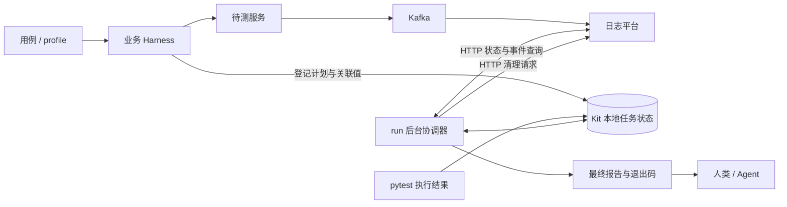

# AITest 异步日志断言升级总体方案

2026-11-19 修订 · 人工评审稿

本文说明升级目标、职责、运行过程和主要取舍。四份详细实现 Spec 的入口在第 8 节，涵盖代码接口、数据结构和验收条件。

日志平台已由业务侧完成一版，本次可核对的接口依据为现有交接稿，实际服务行为需在可访问环境中联调确认。文中以“建议”标注尚待评审的方案选择。

## 1. 目标与现状

本次升级要让一条自动化用例同时具有即时断言和日志断言。请求返回后继续执行后续用例，日志就绪后由后台验证，整轮测试最终给出完整结论。成功用例按策略释放日志，失败用例留下排查依据。

已确认的设计方向包括以下几项。

- 日志平台负责采集、存储和查询，AITest 通过 HTTP 接口验证和申请清理。
- 各业务 Harness 适配服务协议，Mixer 的 `reqId`、`mask` 归 Mixer 接入代码管理。
- Markdown 描述业务场景，profile 和 Harness 接入执行，Kit 负责通用调度与结果汇总。
- 用例支持可配置并发。日志断言支持以字符串编写代码，AI 能通过 profile 声明、校验并解释这些检查。
- 升级兼顾旧 workspace 和 `naiyue-test-agent` 的 CLI、云端测试与报告交付。

当前 `aitest run` 在 pytest 子进程结束后读取 JUnit、写报告，再使用 pytest 退出码结束。多 suite 任务逐个执行后聚合。因此主要升级点是运行协调、用例结果合并和清理时机。[现有运行与汇总](../../aitest_kit/report/cli.py)

实施基线建议使用已发布的 Kit `v0.6.0`。当前讨论工作目录标为 `0.5.0`，Agent 云端工具链锁定 `0.6.0`，实施时需以发布基线核对兼容范围。

## 2. 架构与职责



| 位置 | 主要职责 |
| --- | --- |
| suite Markdown / profile | 描述预期，声明检查哪个请求、哪些事件与字段，以及期望值 |
| Module Harness | 设置业务采集参数，发送业务请求，取得日志关联值，调用 Kit 登记能力 |
| fixture | 创建和释放 Harness、客户端等测试资源 |
| Kit 后台协调器 | 在整轮 run 内调度待验证任务，查询日志、执行断言、合并结果、安排清理 |
| Kit 日志平台客户端 | 统一处理来源、认证、分页、版本、错误与清理幂等，将接口差异收在此处 |
| Kit 报告与 Console | 展示即时结果、日志检查、等待进度和清理情况，生成一致的最终结论 |
| 日志平台 | 消费 Kafka、判断采集状态、保存事件，接受查询、下载和清理 |

后台等待发生在 run 协调器中。fixture 的资源释放完成后，后台依靠已登记的数据继续验证。测试服务的地址与日志平台的地址分别配置。

## 3. 业务接入与断言表达

### 3.1 采集触发与请求关联

Kit 接收“日志来源 + 日志关联值”。同一来源内，关联值必须能够唯一定位本次请求。业务服务的字段名称、位置和生成方式由 Harness 适配。

| 服务约定 | Harness 的处理 |
| --- | --- |
| Mixer 在请求体使用 `reqId`、`mask` | 生成符合业务规则的 ID，按配置设置采集位，带入请求 |
| 服务通过请求头触发采集并传追踪 ID | 按该服务协议构造请求头，并登记对应关联值 |
| 服务在响应中返回追踪 ID | 发请求前登记检查意图，收到响应后提取并绑定关联值 |

日志平台按来源配置提取业务报文中的关联字段，并在 API 中统一使用 `reqId/reqIds`。Kit 的 HTTP 客户端按这个协议查询。平台字段映射与 Harness 提交的值需要一致。[日志平台字段映射](log_capture_platform_configuration.md#31-如何填写一份报文映射)

每次业务调用另有 Kit 内部请求身份，用于关联 run、suite 单元、pytest 用例实例、执行次数和请求步骤。同一用例发多次请求时分别登记，重试产生新的请求身份。并发执行时以这些信息归属结果，避免跨 suite 重名、参数化或重试的用例串用日志。

### 3.2 用例作者怎样写断言

Markdown 记录业务预期，suite profile 负责执行接线。已有 `case_flows.steps[].assert` 在 pytest 用例中立即检查响应。建议在同一条 flow 下新增与 `steps` 并列的 `log_assertions`，专门声明后台执行的 Python 断言。Kit 在生成阶段就能找到全部规则，发请求前登记检查意图。Harness 只提供业务调用和关联值。[现有 profile 写法](../usebook/codegen_profile_guide.md)

下面是拟议的完整 flow 示例。用例要求响应成功，且该请求恰好有一条命中事件，其日志消息包含指定文本。`harness.query`、事件正文的 `message` 字段及消息内容都是该示例服务的约定，`log_assertions` 是新增设计。

```yaml
case_flows:
  TC-DEMO-001:
    steps:
      - call: harness.query
        save_as: reply
      - assert: 'assert reply["code"] == 200'
    log_assertions:
      - request_step: reply
        select: {eventType: SCENE_HIT}
        expected: {keyword: "命中"}
        checks:
          - 'assert len(events) == 1'
          - 'assert expected["keyword"] in events[0]["data"]["message"]'
```

`request_step` 引用同一 flow 中发出该次业务请求的步骤名（这里复用 `save_as`）。Kit 将它绑定到本次运行的实际请求，日志平台查询仍用第 3.1 节的来源和关联值。一个用例中的多次请求分别命名。后台取得指定请求完整、同版本的全部事件页，按 `select` 选出事件，保持平台顺序，将结果作为 `events`。没有匹配事件时得到空列表。`checks` 按顺序执行，前置数量检查失败即报告该断言，便于定位。

**代码字符串可以检查文本，也可以检查 JSON 原有类型。** 若 `data` 本身是文本，可写 `assert "命中" in events[0]["data"]`。若正文包含数值，可写 `assert events[0]["data"]["score"] >= expected["min_score"]`。建议首版支持比较、索引、包含、字符串方法、常用正则匹配，以及使用 `len`、`any`、`all` 检查多条事件。日志正文始终作为输入数据。后台执行经 codegen 校验的 profile 断言，输入限于事件快照、显式传入的 `expected` 及文档列明的纯函数。响应派生的期望值在请求返回后提取并冻结，后台无需访问 pytest 的局部变量或 fixture。

### 3.3 AI 怎样发现和校验能力

- **写法可发现。** 项目和 `aitest init` 分发的 JSON Schema、profile 手册、`test-scaffold` 与 `test-codegen` 指南使用同一个示例。手册列出上下文名称、输入类型、支持的操作，以及纯文本、JSON、多事件和响应派生期望的例子。Kit 优先读取工作区里的 Schema。已有 workspace 启用新语法时，须能通过模板升级流程同步 Schema 和 Agent 实际读取的指南，保留用户自定义内容。[Schema 加载顺序](../../aitest_kit/codegen/profile_schema.py)
- **错误能在发请求前发现。** `codegen --validate-profile` 离线检查字段、请求步骤引用、Python 断言语法、可用名称和支持的操作。把即时变量 `reply` 直接写进后台断言时，错误应定位到 TC-ID 和具体规则，并提示把所需字段传入 `expected`。事件实际内容及响应值在运行时检查。
- **生成结果可核对。** `--dump-ir` 和 `--explain <TC-ID>` 展示即时断言、后台断言、请求步骤和输入来源。`--check` 覆盖规则修改后的生成新鲜度。报告保留失败表达式、请求标识及经过脱敏的实际值摘要，使 Agent 能区分业务不符、规则出错与缺少证据。

## 4. 一轮测试怎样运行

建议每轮 `aitest run` 共用一个后台协调器。单 suite、task、module、target 和 all 都按整个运行范围协调。

### 4.1 两个并发数

建议分别设置两个正整数，配置属于一次运行。名称和默认值供评审。用例数限制对待测服务同时施加的工作量，日志数限制对独立日志平台的读取和校验压力。两者的延迟、容量和调优依据各不相同。

| 建议配置 | 一个名额覆盖什么 | 设为 1 时 |
| --- | --- | --- |
| `case_concurrency`，默认 1 | 一个 pytest 用例实例的 setup、业务调用、即时断言和 teardown，结束即释放。用例内的步骤保持作者声明的顺序 | 当前用例即时阶段结束后才启动下一个，前一条的日志可在后台继续验证 |
| `log_concurrency`，建议初始默认 1，可独立调大 | 对一个已就绪请求按版本读取事件并执行其全部日志规则。同一请求的多条规则复用一次读取 | 后台一次验证一个已就绪请求。尚在采集的请求留在待办队列，批量查询状态，不占验证名额 |

例如配置为 `4 / 2` 时，最多四条用例同时执行即时阶段，后台最多同时验证两次请求。配成 `1 / 1` 时，两阶段各自串行，仍允许 A 等日志期间执行 B 的业务请求。并发数限制同时在途的工作，实际每秒请求数还取决于响应速度和每例调用次数。若某个 Harness 自行并发发送多次调用，该行为需由模块单独约束。

建议沿用 suite 原有启动顺序，在当前 suite 内并发调度独立用例。run 内所有 suite 和执行进程共享上述上限，前一个 suite 遗留的日志仍可验证。开启用例并发的业务模块应隔离测试账号、可变业务数据和清理对象。共享同一资源且依赖先后顺序的用例以并发 1 运行。

工作区可配置默认值，本轮运行可显式覆盖，报告记录生效值。旧 workspace 默认串行，无日志检查时无需日志服务。现行 Kit 接受 pytest 参数透传，若调用者已自行配置并发，升级需识别它与 Kit 显式上限的冲突，给出一套可解释的生效值。若并发实现引入 pytest 插件，须将其纳入 Kit 安装和云模板依赖验收。

### 4.2 从登记到报告

1. **准备检查。** 加载日志访问配置，校验规则与来源能力，持久化待验证计划和截止时间。采集关联值可提前绑定，也可在响应返回后补齐。
2. **发送请求。** Harness 按业务协议触发采集，收到响应后保存关联值和检查所需的响应数据，执行即时断言。
3. **继续用例。** pytest 执行后续用例。Kit 同时记录每条用例的 setup、call 和 teardown 结果，完成日志检查所需的数据可以独立于 fixture 存活。
4. **后台验证。** 协调器按来源批量查询状态，优先处理即将过期的请求。日志完整且可读时，按一致版本取得事件并执行检查，及时保存结果。
5. **形成用例结论。** 即时执行与该用例的全部日志检查都有终局后合并结果。单条用例成功且结果已经保存时，即可按策略提交它的日志清理。
6. **结束整轮。** 各 suite 的即时执行结束后，继续处理剩余待验项，直到完成或达到各自截止时间。需要清理的请求取得提交回执或达到提交期限后，写出最终报告，命令返回最终退出码。

例如 A 的日志晚于 B 到齐，A 返回响应后 B 可以继续执行，后台先完成 B 的日志检查。多 suite 运行时，同样允许后一个 suite 与前一个 suite 的日志等待重叠。

**后台从测试执行期间就开始工作。** 短 TTL 下要边查边保存检查结果，整轮耗时可以长于单条日志的保留期。已保存的检查结果仍可用于最终汇总。

建议首版使用有界批量轮询驱动后台任务，内部登记动作可以提前唤醒扫描。轮询、读取并发和待办数量均配置上限，任务积压达到上限时，对新登记明确反馈容量问题。查询和重试受请求截止时间约束。

## 5. 状态、报告与清理

日志平台的“采集完整”表示证据可用于验证。用例通过还需要业务断言符合预期，以及即时执行和收尾成功。Kit 通过 pytest 阶段结果接入用例生命周期。[pytest 阶段报告钩子](https://docs.pytest.org/en/stable/reference/reference.html#pytest.hookspec.pytest_runtest_makereport)

| 观察到的情况 | 建议的处理与报告 |
| --- | --- |
| 即时检查通过，日志仍在等待 | 显示待验证，暂不计入通过数 |
| 日志完整可读，但字段、数量或事件不符合预期 | 记录日志断言失败，展示期望、实际值和对应事件 |
| 即时检查、日志检查和用例收尾均成功 | 用例通过，按清理策略释放关联日志 |
| 尚未观察到请求或正在采集 | 截止时间内继续查询，记录等待进度 |
| 日志不完整、过期、已删除，或来源缺少结束契约 | 记录具体证据问题；完整断言缺少必要条件时结束为错误 |
| 平台暂时不可达或返回可重试错误 | 在剩余时间内有界重试，到期记录访问问题 |
| 请求失败且没有取得日志关联值 | 保存请求错误及关联失败原因，任务结束 |
| 运行取消或进程中断 | 保留已完成结果，未完成项显示取消或中断 |

等待时间以本次请求的检查截止时间为基础，获知平台 `expires_at` 后收紧读取窗口。读取分页期间出现版本变化时重新获取一致快照，过期或删除时明确结束。来源没有完成能力时，登记完整性检查应提前给出配置错误。[平台状态与分页契约](log_capture_platform_delivery/02_http.md)

`result.json` 继续作为结构化事实源，增加日志检查进度、结论、请求关联和清理摘要。`report.md`、JUnit 最终产物、汇总统计与退出码需要表达一致结论。Console 应显示待验证与错误原因，历史报告缺少新增字段时沿用原有解释。结果按本轮 run 保存，恢复旧 run 时应避免覆盖新 run 的 `latest`。

**清理由用例策略表达，实际发送由后台安排。** 建议接入日志检查的用例可选择“成功后释放”或“保留到 TTL”。成功后释放需要等全部使用该请求的检查完成、用例即时执行及收尾成功，并保存最终结果。Kit 提供可复用清理能力，业务 Harness 或用例流程声明清理意图，后台调用精确 ID 删除接口。

失败、错误或中断的请求保留到平台 TTL。报告保存相关事件定位、期望值和有界实际值摘要，较长时间排查可使用现有下载能力保存完整日志。

建议以“本地清理意图已保存，平台已返回 `202` 回执”作为本轮清理提交完成，提交与重试设置独立的有界期限。回执中的任务 ID 用于后续查询物理删除进度，本轮报告记录已知的受理状态。重试复用幂等键，提交问题单独展示并保留断言结论。提交失败是否影响整轮退出码列入第 8 节评审项。

## 6. 本地状态、接口与配置

建议使用 Python 标准库 `sqlite3` 保存每轮运行的检查计划、进度、结果和清理意图。SQLite 使用本地文件并支持事务，适合本次运行恢复所需的小规模状态。数据库连接与并发写入方式在执行分片中细化。[Python SQLite 文档](https://docs.python.org/3.9/library/sqlite3.html)

状态中保存请求归属、规则版本、已冻结的必要期望值、截止时间和验证结果。完整原始日志按需读取或导出，本地记录控制摘要大小和保存期限。凭证通过运行环境读取，任务状态存放在独立于报告发布目录的位置。

建议支持在原工作区保留的前提下恢复未完成检查。恢复沿用原关联值、规则和截止时间，继续查询及幂等清理；业务请求是否成功未知时记录明确状态。云端临时工作区被回收后，恢复能力取决于运行状态是否仍可取得。

对接平台所需的核心能力如下，接口路径以交接稿为依据。

| 接口能力 | 使用时机 |
| --- | --- |
| `GET /v1/sources` | 确认来源可见、可用动作与完成能力 |
| `POST /v1/requests/status` | 按来源批量查询已绑定请求的采集与可用状态 |
| `GET /v1/requests/{reqId}/events` | 按版本分页取得断言所需事件和正文 |
| `POST /v1/cleanup` 及回执查询 | 按精确请求集合提交清理，记录受理和完成情况 |

关键配置按职责归属，实际字段名称、默认值和优先级由后续 Spec 定义。

| 配置内容 | 建议归属 |
| --- | --- |
| 日志平台地址、Token | 运行环境提供实际值，配置只引用环境变量名 |
| 来源、采集协议、关联值取得方式 | target/module 接入配置与 Harness |
| 事件筛选、断言代码字符串、冻结的期望值来源、请求步骤、清理意图 | suite profile 绑定用例，module profile 记录稳定业务能力 |
| 用例并发数、日志验证并发数、检查期限、轮询间隔、HTTP 超时与重试、待办上限 | Kit 运行配置，全 run 生效 |
| 状态保存目录与期限、证据摘要大小 | Kit 运行配置 |

现有前缀授权也要与实际关联值一致。服务端生成的 ID 若不带 `at-` 前缀，应按业务来源配置匹配的权限范围，由 Kit 使用的凭证显式授权 read、cleanup 等动作。

## 7. 兼容范围与 Agent 交付

建议将日志检查作为显式接入能力。旧 workspace 的配置、generated pytest、运行选择器和历史报告纳入回归，接入的 suite 经 profile/Harness 扩展后重新生成。直接执行使用新能力的 pytest 时，缺少协调器应给出可诊断的前置错误。

| 兼容位置 | 本次要求 |
| --- | --- |
| codegen | 扩展可选 flow 字段、Schema、语义校验、IR、生成和解释，旧 profile 及其生成结果继续通过原有检查 |
| run / report | 已有参数和退出码含义兼容；旧用例可在无日志配置的环境执行；日志检查参与新用例最终判定 |
| Python 报告接口 | `collect_result()`、`render_markdown()` 的现有导入路径、参数和基础报告字段兼容 Agent 预检 |
| Console | 成功、等待、失败和中断状态与最终结果一致 |
| Agent 云端文件 | 在 Kit 得到终态后，按现有流程把报告放入任务产物目录，由既有快照和下载链路交付 |

当前 Agent 云端固定 Kit `0.6.0` 和 wheel 摘要。升级交付包括新版 Kit wheel、Agent 依赖锁及摘要更新、Runner 模板重建和预检。云端优先使用项目 `.venv`，启用新能力时也要核对该解释器安装的 Kit 版本。日志地址须从实际 Runner 环境验证可达，可使用既有网络入口或隧道。

上述边界已按本机 Agent 源码核对。可追溯入口包括 `release/cloud-test-toolchain.json`、`release/cloud-test-requirements.txt`，以及源码包 `naiyue_test_agent/cloud_runner/` 下的 `kernel.py`、`preflight.py` 和 `output_snapshot.py`。实际换包、模板运行与日志平台联调在实施验收中完成。

## 8. 评审重点与后续分片

本轮建议优先讨论以下选择。

| 评审问题 | 当前建议 |
| --- | --- |
| profile 如何表达日志检查 | 用例的 `steps[].assert` 表达即时检查，同层 `log_assertions` 绑定请求步骤并保存后台断言代码字符串。校验、解释、模板与 AI 指南一起交付 |
| 用例和日志验证如何限并发 | 分开设置，全 run 共用，默认均为 1。通过两个阶段独立调度，使慢日志不占用用例执行名额 |
| 一轮测试何时结束 | run 内并行推进即时执行和日志验证，全部结束或到期后返回最终结论 |
| 本地状态与恢复做到哪一步 | SQLite 持久化，支持原工作区内恢复检查和清理，沿用原截止时间 |
| 清理怎样收尾，提交失败怎样影响执行结果 | 平台受理后结束本轮清理提交，物理删除凭回执查询。提交期限内仍失败时单列异常，建议整轮返回非零以便发现收尾问题，具体归类与退出码由结果分片明确 |

下表链接到四份实现前详细 Spec，按依赖顺序阅读。分片 1 定义用例语言和客户端，分片 2 负责运行事实，分片 3 由这些事实生成结论，分片 4 验证安装后的整条链路。具体接口与验收条件以对应分片为准。

| 分片顺序 | 详细 Spec 要解决的问题 | 主要验收结果 |
| --- | --- | --- |
| [1. 用例接入与规则契约](aitest_log_assertions/01_profile_and_client.md) | 关联与绑定、profile 断言字符串、Schema、IR、解释和生成、模板指南、HTTP 客户端契约 | AI 根据安装后 workspace 的指南和示例写出可通过校验的文本与 JSON 检查，写错阶段变量能定位到规则，旧用例生成兼容 |
| [2. 并发执行与状态](aitest_log_assertions/02_execution_and_recovery.md) | 用例调度、两阶段并发配置、pytest 阶段记录、状态存储、短 TTL、截止时间和恢复 | 用受控阻塞验证 `1 / 1` 的阶段顺序和 `4 / 2` 的真实重叠与全 run 上限，覆盖不同 suite、参数化与重试归属，慢日志期间 B 可执行 |
| [3. 最终结果与清理](aitest_log_assertions/03_results_and_cleanup.md) | 用例合并、报告与退出码、Console、清理意图和幂等重试 | 日志失败影响最终结果，成功后按策略清理，错误原因可追溯 |
| [4. 接入验收与云端交付](aitest_log_assertions/04_acceptance_and_agent.md) | 完整样例、旧功能回归、真实平台接口核对、wheel 与模板验收 | 旧 workspace 可运行，新用例在云端产生正确报告并可下载 |

验证依次使用模拟 HTTP 响应、真实日志平台和实际 Runner 环境。重点覆盖通过、日志不符、证据缺失、关联失败、过期、跨页版本变化、清理重试、运行中断，以及不同 suite/参数化用例的请求归属。前一阶段的验证结果作为后一阶段的输入。
